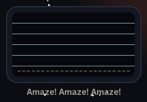
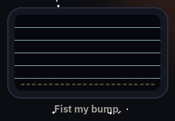
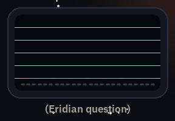
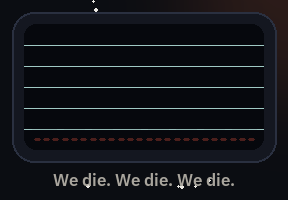
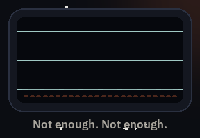
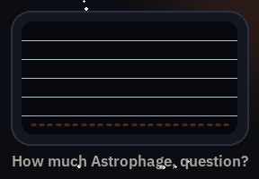

<h1 align="center">
  <a href="https://mitchtech.github.io/agent-rocky/"></a>
</h1>

<p align="center">
  <a href="https://github.com/mitchtech/agent-rocky/actions/workflows/check.yml"></a>
  <a href="https://github.com/mitchtech/agent-rocky/releases/latest"></a>
  <a href="LICENSE"></a>
  <a href="audio/NOTICE.md"></a>
</p>

<p align="center"><b>Your coding agent says <i>Amaze! Amaze! Amaze!</i> when it finishes, asks <i>question?</i> when it needs you, and admits <i>not enough, not enough</i> when your usage runs out.</b></p>

<p align="center">
  <a href="https://mitchtech.github.io/agent-rocky/"><b>Hear every clip</b></a> ·
  <a href="#sounds">Event map</a> ·
  <a href="https://github.com/mitchtech/agent-rocky/releases">Releases</a> ·
  <a href="https://github.com/mitchtech/agent-navi">Agent Navi</a> ·
  <a href="https://github.com/mitchtech/agent-johnny5">Agent Johnny 5</a> ·
  <a href="https://github.com/mitchtech/agent-warcraft">Agent Warcraft</a> ·
  <a href="https://github.com/mitchtech/agent-starwars">Agent Star Wars</a> ·
  <a href="https://github.com/mitchtech/agent-starcraft">Agent StarCraft</a>
</p>

<table align="center">
  <tr>
    <td align="center"><br><sub>Turn finished</sub></td>
    <td align="center"><br><sub>Turn finished</sub></td>
    <td align="center"><br><sub>Needs approval</sub></td>
    <td align="center"><br><sub>Destructive command</sub></td>
    <td align="center"><br><sub>Out of usage</sub></td>
    <td align="center"><br><sub>Usage low</sub></td>
  </tr>
</table>

Rocky sound notifications for coding agents, from *Project Hail Mary*. Native
sound integrations for **Claude Code**, **Codex**, and **Gemini CLI**, plus a
small event interface for other agents and scripts. One shared player supports
macOS, Linux, and Windows. A Codex pet slot ships ready for Rocky's art.

Agent Rocky plays 44 clips on agent events: 38 of Rocky's lines from the film
and 6 untranslated Eridian chords.

- "Hello, Grace friend." when a session starts and "Rocky fix." when you send a prompt.
- "What problem, question?" when an approval is waiting, and "We die. We die.
  We die." when that approval is for `rm -rf`, a force push, or a dropped table.
- "Amaze! Amaze! Amaze!" or "Fist my bump." when a turn finishes.
- "Not enough. Not enough." when Claude Code stops on a rate limit or billing error.
- "Rocky hate Mark." when you send three prompts in ten seconds.

The Eridian chords follow the film's own recipe for Rocky's voice: ocarina,
didgeridoo, and whale song, pitched and layered into chords. They are built
from CC0 recordings, so every event still has a sound if the film clips ever
have to go. It runs locally, sends no telemetry, and never approves or blocks
an agent's actions.

A sibling of [Agent Navi](https://github.com/mitchtech/agent-navi),
[Agent Johnny 5](https://github.com/mitchtech/agent-johnny5),
[Agent Warcraft](https://github.com/mitchtech/agent-warcraft),
[Agent Star Wars](https://github.com/mitchtech/agent-starwars), and
[Agent StarCraft](https://github.com/mitchtech/agent-starcraft), inspired by
[thephw/claude-meseeks](https://github.com/thephw/claude-meseeks).

## Choose your setup

| Choice | Install | Requirements |
|---|---|---|
| Sounds | [Agent plugin](#install) or standalone CLI | Node.js 22+ and local audio |
| Astrophage meter | [Status line command](#astrophage-meter-and-usage-alarms) | Claude Code status line |
| Codex pet | [Coming soon](#codex-pet-coming-soon) | A host with compatible custom pets |

Installing the sound plugin never installs or selects a pet, and never changes
your status line.

## Sound requirements

- **Node.js 22 or newer**, with `node` on the agent's `PATH`.
- **macOS:** built-in `afplay`.
- **Linux:** `paplay`, `pw-play`, `aplay`, or `ffplay`, with a working local audio device.
- **Windows:** Windows PowerShell (`powershell.exe`), using `System.Media.SoundPlayer`.

No npm runtime dependencies, Bash, or `jq` are required. Windows hooks and audio
playback do not require Git Bash. A headless machine without an audio device
cannot play sounds on your laptop automatically.

## Install

### Claude Code

```bash
claude plugin marketplace add mitchtech/agent-rocky
claude plugin install rocky@agent-rocky
```

Inside a Claude Code session, the same steps are `/plugin marketplace add` and
`/plugin install`.

### Codex

```bash
codex plugin marketplace add mitchtech/agent-rocky
codex plugin add rocky@agent-rocky
```

Review and trust the installed hooks in Codex's hook settings before using them.
Installing or enabling the plugin does not automatically trust its hook commands.
Restart the agent after installation or updates.

### Gemini CLI

```bash
gemini extensions install https://github.com/mitchtech/agent-rocky
```

Gemini selects a self-contained ZIP for your platform from GitHub Releases.
Review the extension's hook consent prompt and restart Gemini. For local
development:

```bash
npm run gemini
gemini extensions link ./dist/gemini
```

The repository root is for shared sources and discovery; Gemini's executable
hook file is included in the generated extension, not the source root. Install
published release assets rather than linking the repository root or a raw Git
branch. See [Gemini integration](docs/gemini.md).

### Running alongside the sibling plugins

Agent Navi, Agent Johnny 5, Agent Warcraft, Agent Rocky, Agent Star Wars, and
Agent StarCraft all respond to the same events. Enable one per host unless you
want a fairy, a robot, a peon, an Eridian, two droids, and an SCV talking over
each other. For example,
`claude plugin disable warcraft@agent-warcraft` for Claude Code, or
`enabled = false` under `[plugins."warcraft@agent-warcraft"]` in
`~/.codex/config.toml` for Codex.

### Local development

```bash
git clone https://github.com/mitchtech/agent-rocky.git
cd agent-rocky
node scripts/rocky.mjs doctor
```

Use `claude plugin marketplace add /absolute/path/to/agent-rocky` for Claude Code or
`codex plugin marketplace add /absolute/path/to/agent-rocky` for Codex, followed by
the same plugin installation command above. `claude --plugin-dir /absolute/path/to/agent-rocky`
tries it for one session without installing.

### Standalone command

For the `agent-rocky` command outside an agent plugin:

```bash
npm install -g github:mitchtech/agent-rocky
agent-rocky doctor
agent-rocky play approval_required --session my-session --tool Bash
agent-rocky preview fist-my-bump
```

All commands also work as `node /path/to/agent-rocky/scripts/rocky.mjs ...`.
Standalone `play` and `preview` wait for the short clip; native hooks dispatch
playback to a detached worker so the agent can continue immediately.

## Codex pet (coming soon)

The Rocky Codex pet is not bundled yet. The installer, validation, and release
packaging are in place, so the pet will arrive in a release without changing
how anything else works. Until then, `agent-rocky pet status` reports
`not-bundled` and `agent-rocky pet install` changes nothing. Codex's native
pet feature can create a companion in the meantime. See [pets](docs/pets.md).

## Sounds

| Shared event | When | Lines | Default |
|---|---|---|---|
| `session_started` | A session starts, resumes, or clears | "Hello, Grace friend." "Hello, Grace." "Hi, Grace." "I am Rocky." "Can hear." | On |
| `prompt_submitted` | You send a prompt | "Yes?" "Rocky fix." "Science! Save Earth! Save Erid! Good plan!" "Words of encouragement." "Thumbs up, baby." | On |
| `annoyed` | Your third prompt inside ten seconds | "Is this room for garbage?" "Rocky hate Mark." "Grace look disgust when you eat." | On |
| `approval_required` | A tool needs permission | "What problem, question?" "Astrophage sampler in position, question?" (Eridian question) | On |
| Approval for shell commands or file edits | | "What's this down here, question?" | On |
| Approval for a destructive command | | "We die. We die. We die." "Bad, bad, bad." (agitated Eridian chord) | On |
| `input_required` | The agent asks you a question | "Who is Grace talking to, question?" (Eridian question) | On where available |
| `ready_for_input` | Claude Code is idle and waiting | "This room boring." (low Eridian hum) | On for Claude |
| `turn_completed` | The agent finishes responding | "Amaze! Amaze! Amaze!" "Good, good, good." "Fist my bump." (bright Eridian chord) | On |
| `out_of_astrophage` | Rate limit, billing error, account on hold, or budget spent | "Not enough. Not enough." (low Eridian minor chord) | On for Claude |
| `astrophage_low` | The Astrophage meter crosses its threshold | "How much Astrophage you need, question?" | On with the meter |
| `out_of_xenonite` | A reply hits the output token limit | "Too much! Too much! Too much!" | On for Claude |
| `error` | Claude Code stops on any other API error | "Bad, bad, bad." (low Eridian minor chord) | Off |
| `tool_failed` | A tool call fails | "Could not fix." "Dirty, dirty, dirty." | Off |
| `subagent_started` | A subagent starts work | "Grace Rocky save stars." "Rocky will build workshop here." (Eridian greeting) | Off |
| `context_compacting` | Context is about to be compacted | "Rocky can't forget." | Off |
| `session_ended` | A session ends | "Grace go home." "We go home." "Thank you, thank you, thank you." | Off |
| Easter egg | | Rocky's purr, his singing, his song, and "Six seven, question?" | 2% of session, prompt, ready, and completion cues |

Parenthesized entries are Eridian chords. Every line and its source is listed in
the [audio notice](audio/NOTICE.md), and [sound notes](docs/sounds.md) explain
the mapping and how to swap in your own clips.

**Destructive commands** are recognized from the approval request's command:
`rm` with recursive and force flags, `git push --force` or `-f` (not
`--force-with-lease`), `git reset --hard`, `git clean -f`, `DROP TABLE`/`DATABASE`/`SCHEMA`,
`TRUNCATE TABLE`, `mkfs`, `dd of=`, `chmod -R 777`, `Remove-Item -Recurse -Force`,
and `rmdir /s`. The alarm is a louder cue, not a safety check: it never blocks,
approves, or logs the command. Only a yes/no flag leaves the hook process.

**Annoyed** lines replace the third and later prompts sent within ten seconds
in the same session. Only timestamps are stored, never prompt text. Turn them
off with `agent-rocky mute annoyed`.

**Easter eggs** never replace approval, question, error, or destructive-command
cues. Turn them off with `agent-rocky mute easter-egg`.

Subagent completion is silent. Idle/input notifications and completion events
are distinct; event availability depends on the host. See
[compatibility](docs/compatibility.md).

## Astrophage meter and usage alarms

Claude Code's `StopFailure` hook reports why a turn failed. Agent Rocky maps
`rate_limit`, `billing_error`, and `account_on_hold` to `out_of_astrophage`,
`max_output_tokens` to `out_of_xenonite`, and anything else to `error`. A
`quota_auto_resume_disabled` notification also plays `out_of_astrophage`.

For a warning before the fuel runs out, add the meter to your status line. It
prints how much of your tightest limit is left and asks "How much Astrophage
you need, question?" once per session when it crosses `astrophage.lowPercent`
(80% used by default), then "Not enough. Not enough." at 100%. The status line
runs outside the plugin, so it needs the [standalone command](#standalone-command)
(`npm install -g github:mitchtech/agent-rocky`):

```json
{ "statusLine": { "type": "command", "command": "agent-rocky statusline" } }
```

```text
⬠ 18% astrophage (5h) low
```

The meter reads Claude Code's 5-hour, 7-day, and spend-limit percentages when
your plan reports them. Set `astrophage.budgetUsd` to also count a per-session
dollar budget against `cost.total_cost_usd`. To keep an existing status line,
call the meter from your own script; see [budget and status line](docs/budget.md).
Codex and Gemini have no equivalent hook; scripts there can run
`agent-rocky play out_of_astrophage`.

## Sound controls

```bash
agent-rocky status
agent-rocky mute prompt_submitted
agent-rocky unmute prompt_submitted
agent-rocky mute annoyed
agent-rocky mute easter-egg
agent-rocky unmute subagent_started
agent-rocky mute all
agent-rocky unmute all
agent-rocky preset attention
agent-rocky preset default
agent-rocky list
agent-rocky config --effective
```

Changes persist immediately and apply to the next hook, without restarting.
Global mute/unmute preserves individual event preferences.

- The **attention** preset keeps the approval, question, ready, and usage
  alarms (`out_of_astrophage`, `astrophage_low`, `out_of_xenonite`). It turns
  off session, prompt, annoyed, completion, error, tool-failure, subagent,
  compaction, and session-end cues.
- The **default** preset restores event enablement. It leaves your custom
  clips, audio directory, easter-egg setting, and global mute preference
  unchanged.

The bundled `rocky-control` skill also handles requests such as "mute Rocky",
"turn off amaze amaze amaze", "stop the annoyed lines", or "set up the
Astrophage meter" inside supported agents. It uses the bundled CLI, so no
global npm installation is needed. `status --json` and `list --json` provide
structured output. Status shows when `AGENT_ROCKY_MUTE` overrides the saved
global mute setting.

## Configuration

Configuration stays outside plugin caches, so updates preserve your settings:

- macOS/Linux: `~/.config/agent-rocky/config.json`, or `$XDG_CONFIG_HOME/agent-rocky/config.json`.
- Windows: `%APPDATA%/agent-rocky/config.json`.

Create the parent directory and save the settings you want to override:

```json
{
  "muted": false,
  "audioDir": "./audio",
  "cooldownMs": 1000,
  "astrophage": { "budgetUsd": 20, "lowPercent": 75 },
  "easterEgg": { "chance": 0.05, "clips": ["purr"] },
  "events": {
    "session_started": { "clips": ["hello-grace-friend"] },
    "turn_completed": { "clips": ["amaze-amaze-amaze", "fist-my-bump"] },
    "approval_required": { "clips": ["what-problem"], "changeClips": ["down-here-question"], "dangerClips": ["we-die"] },
    "subagent_started": { "enabled": true },
    "context_compacting": { "enabled": true }
  }
}
```

For quiet offices, an Eridian-only setup keeps every cue but drops the English:
set each event's `clips` to its `eridian-` chords from `agent-rocky list`.

Omit `audioDir` to use bundled clips. Relative directories resolve from the
configuration file's directory. Custom audio directories must contain a
`<clip>.wav` for every name in `agent-rocky list`; use 16-bit PCM WAV for
compatibility with all players. Copy the clips to your own directory before
replacing them. Installed plugin files can be overwritten by updates.

How clip settings work:

- An event's `clips` array selects one sound at random. Use one entry for a fixed sound.
- `changeClips` applies to shell and file-change approvals.
- `dangerClips` applies to destructive-command approvals and takes priority.
- `easterEgg.chance` is a probability from 0 to 1.
- `astrophage.budgetUsd` is `null` (rate limits only) or a positive dollar
  amount. `astrophage.lowPercent` is between 0 and 100.
- Each event accepts `enabled: false` to mute it independently.

`agent-rocky config` prints the complete default configuration without
writing anything.

| Environment variable | Effect |
|---|---|
| `AGENT_ROCKY_MUTE` | `1` mutes; `0` unmutes; overrides `muted` |
| `AGENT_ROCKY_CONFIG` | Explicit configuration file path |
| `AGENT_ROCKY_AUDIO_DIR` | Overrides the audio directory |
| `AGENT_ROCKY_STATE_DIR` | Overrides the local playback state directory |

Configure environment variables before starting the agent.

Repeats and overlaps are handled like this:

- Repeated events within `cooldownMs` for the same agent, session, and event are
  suppressed.
- A global playback lock drops overlapping clips across sessions.
- Claude's delayed permission notification is suppressed for at least 10 seconds
  after a matching approval alert. A permission notification without a preceding
  alert can still play.

State contains hashed event and session identifiers with timestamps or fuel
levels only. Inactive records are cleaned up after a day, when another sound plays.

## Other agents

Call the shared interface when your agent emits an attention event:

```bash
agent-rocky play session_started --session example
agent-rocky play prompt_submitted --session example
agent-rocky play approval_required --session example --tool Bash --command "rm -rf build"
agent-rocky play turn_completed --session example
agent-rocky play out_of_astrophage --session example
```

Every event honors its configuration toggle. Integration scripts should treat
playback failures as advisory. No tool-call or transcript polling is needed.

## Troubleshooting

```bash
node scripts/rocky.mjs doctor
node scripts/rocky.mjs preview hello-grace-friend
```

`doctor` reports configuration, paths, player availability, clips, enabled
events, easter eggs, the Astrophage meter, and the optional pet. `doctor --pet`
checks only the pet and works without an audio player or valid sound
configuration. These commands operate without playing anything.

`preview` plays a clip even when muted and bypasses event cooldown, but still
respects overlap prevention. A busy player is reported explicitly instead of
silently skipping the preview. Neither command changes settings.

Native hooks exit successfully on malformed input, invalid configuration, missing
audio/player, or playback failure. They produce no prose or permission decisions.
Codex `Stop` and every Gemini hook emit only `{}` as neutral JSON required by
those hosts. The status-line meter always prints a line, falling back to a bare
`⬠`. Run diagnostics when sounds are missing, and check Node's availability and
hook trust settings.

SSH, containers, WSL, and cloud sessions play on the machine executing the hook.
An audio bridge must already exist if you expect those sounds on another machine.
GitHub marketplace installation is the distribution path; this hook plugin is
not submitted to OpenAI's public plugin directory.

## Development

```bash
npm run check
npm test
npm run test:package
python3 -m pip install -r requirements-dev.txt
python3 scripts/build-audio.py --check
python3 scripts/check-pet.py
python3 scripts/build-assets.py
python3 scripts/package-release.py
npm run site
```

Tests simulate players. They cover:

- host payloads and destructive-command detection
- the annoyed window and usage alarms
- the Astrophage meter and its once-per-session cues
- easter eggs, configuration, deduplication, and overlap
- the manifest-only pet stub
- failures, paths with spaces, and packaging

CI runs Node 22 and 24 on macOS, Linux, and Windows. See
[compatibility](docs/compatibility.md) and [release notes](CHANGELOG.md).

Python/Pillow are development tools for audio provenance, asset validation, and
previews, not runtime dependencies. `build-audio.py` rebuilds the clips from
[their recorded sources](audio/sources.json) with ffmpeg; `--check` verifies the
committed files offline. See [distribution maintenance](docs/distribution.md)
for releases and the site, and [contributor instructions](CONTRIBUTING.md) for
the project workflow.

## Credits and license

- Author: [Michael J. Mitchell / mitchtech](https://github.com/mitchtech).
- *Project Hail Mary* (2021 novel): Andy Weir. *Project Hail Mary* (2026 film): Amazon MGM Studios. Rocky is voiced and performed by James Ortiz.
- Film clip sources: Myinstants uploads and official clips and trailers published on YouTube by Amazon MGM Studios and Prime Video. See the [audio notice](audio/NOTICE.md).
- Eridian chords: built from CC0 recordings on Freesound by NikoletB, alegemaate, Gorkovoy, dethrok, RebekahDay, and kvgarlic, following the film sound team's description of how Rocky's voice was made (Erik Aadahl and Ethan Van der Ryn).
- Sibling projects: [Agent Navi](https://github.com/mitchtech/agent-navi), [Agent Johnny 5](https://github.com/mitchtech/agent-johnny5), [Agent Warcraft](https://github.com/mitchtech/agent-warcraft), [Agent Star Wars](https://github.com/mitchtech/agent-starwars), and [Agent StarCraft](https://github.com/mitchtech/agent-starcraft).
- Original plugin inspiration: [thephw/claude-meseeks](https://github.com/thephw/claude-meseeks).

Code and configuration: [MIT](LICENSE). Film audio is excluded from the
license; see the [audio rights notice](audio/NOTICE.md). Third-party character
rights and trademarks remain with their owners. This is a fan project, not
affiliated with or endorsed by Andy Weir, Amazon MGM Studios, or the film's
makers.
